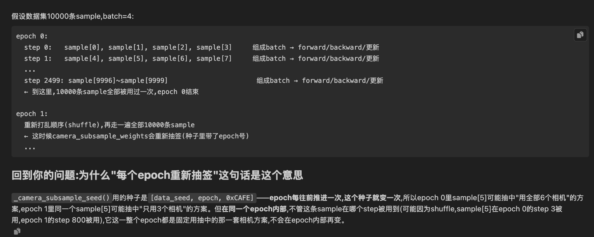

projects/alpax/docs/assets/training_optimizations/ 下的图都是每项技术单独一张的 before/after 图解,文件名前缀对应我们之前聊过的5类新分类(00_测量、01_数据加载、02_传输/Step收尾、03_前向反向、04_并行显存、05_方法论)。01_ 开头的一共17张,都属于"数据加载"这一类——也就是官方新分类里对应你 01_Data_Loading_cn.md 现在这个文件的范围。

对照你现在已经写的三项,能直接对上号的图有3张:

你已写的内容	对应的图
1. 预先分配每帧数据内存占用	01_preallocate_the_decode_output.png
2. 多相机按需加载	01_open_only_the_selected_cameras.png
3. 相机解码线程并发	01_bounded_decode_overlap_for_latency_tails.png
剩下14张是官方"数据加载"这一类里你文件目前还没写的技术,按流程顺序大致是:

存储/解码相关(和你1-3同一小段):

01_seek_to_key_frames_and_cache_open_clips_the_reader_substrate.png — 用索引seek到关键帧+缓存已打开的clip(是Part1-3的底层reader机制)
01_look_up_key_frames_in_the_container_index_and_release_the_fi.png — 按容器索引找关键帧+解码后释放文件句柄
01_decode_only_the_frames_each_camera_keeps_open.png — 只解码每个相机实际用到的帧(open,还没合入)
01_hardware_video_decode_with_gpu_resident_output_draft.png — GPU硬件解码(draft)
CPU预处理/内存相关(你7类里原来的"第2类"):

01_delete_dead_payloads_before_they_ride_the_pipeline.png — 删除死数据(即我之前内部总结里的 Part5 drop_raw)
01_resize_as_uint8_before_converting_to_float.png — uint8 resize(ch16)
01_ship_uint8_patches_and_normalize_at_the_consumer.png — uint8 patch传输(Part13)
01_trim_per_sample_worker_work_behind_a_byte_identity_gate.png — worker CPU瘦身(Parts9-12)
01_rectify_and_resize_on_the_gpu_cross_team_example.png — GPU上做rectify+resize的跨团队示例
worker调度/内存相关(你7类里原来的"第4类",现在并入01):

01_partition_cpus_so_workers_never_share_the_trainer_s_cores.png — CPU分区(ch15)
01_pick_worker_and_prefetch_counts_from_a_measured_frontier.png — worker/prefetch数量(ch14)
01_keep_worker_metadata_columnar_and_read_only_the_columns_you_.png — worker元数据列式存储
01_shard_metadata_by_data_parallel_rank_before_the_workers_fork.png — 按DP rank分片元数据
01_initialize_the_dataset_from_columnar_metadata_and_skip_phase.png — 数据集列式初始化(启动/重启提速,上次提过的5.1×那项)

# camera lazy initializaiton 
