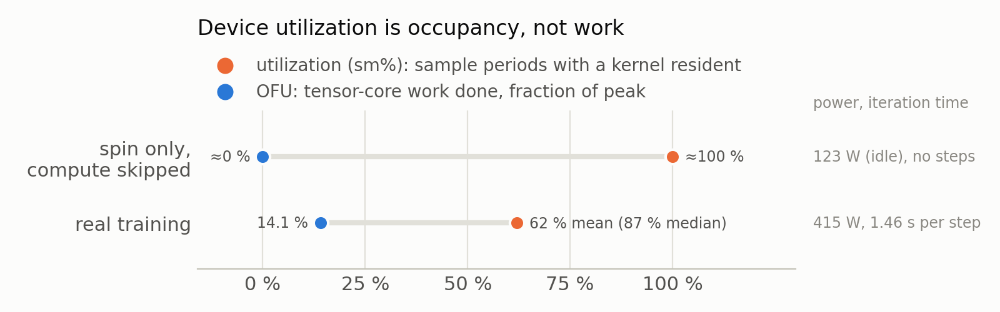
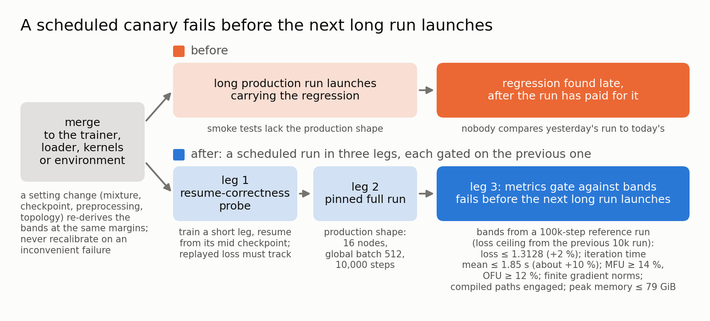
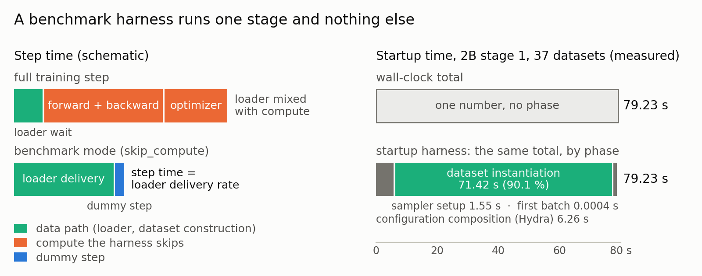
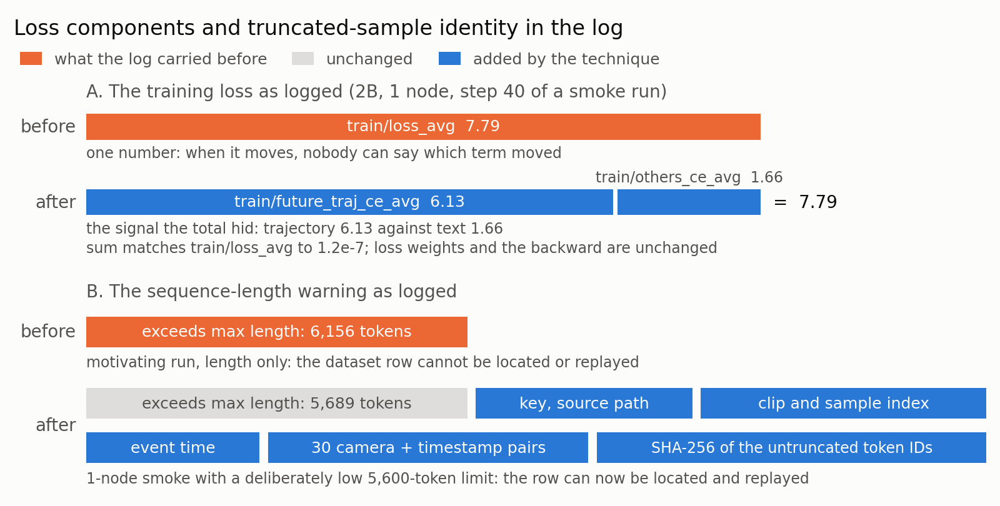

## Summary
本章介绍训练效率的测量与评估方法，按使用顺序分为三部分：怎么量、怎么拆（先找出时间花在哪里），怎么算成本和利用率，以及持续监控与辅助方法；最后是问题定位（按症状找到瓶颈点）。各条后面的编号对应正文的小节。

**怎么量、怎么拆**:先找出时间花在哪里（第 1~3 项）
- 逐 rank 遥测与 `severe stall`: 记录每个 rank 的等待与计算,定位拖慢整体的 rank (见第 1 项)
- `wall clock`: 从日志时间戳算完整的 s/step (见第 2 项)
- CUDA event 分解: 把训练 step 拆成 `arrival` / `forward` / `backward` / `host residual` (见第 3 项)

**怎么算成本和利用率**:按 `wall clock` 算成本，按实际算力看利用率（第 4~5 项）
- `GPU-hour`: 用 `wall clock` 均值算,不用中位数 (见第 4 项)
- `MFU / HFU / OFU`: 看实际算力利用,不看设备利用率 (见第 5 项)

**持续监控与辅助方法**:训练中的持续记录与回归监控,以及单独测量某一段的方法（第 6~10 项持续补充中）
- 回归测试: 代码改动后定期跑固定配方,与基线阈值（带）对比,超出就报警 (见第 6 项)
- NaN / inf 梯度取证: 出现时保存现场用于复现和定位,平时不拖慢训练 (见第 7 项)
- dataloader harness: 跳过 compute 单独计算 dataloader 耗时,并把启动时间拆到各阶段 (见第 8 项)
- 训练日志增强: 细化多模态训练 loss,定位异常输入样本 (见第 9 项)
- profiler: 离线 trace,细到模块和算子 (见第 10 项)

**问题定位**:遇到具体症状时,看对应的指标和瓶颈定位:

| 症状 | 表现 | 看哪些指标 |
|---|---|---|
| 训练 step 慢于硬件预期，原因不明 | 设备利用率（`sm%`）高、loss 正常，但每个训练 step 的 `wall clock` 比硬件预期长 | 真实 `wall clock / step`;`arrival`、`forward`、`backward`、`host residual` (详见第 2、3 项;细到模块和算子见第 10 项) |
| 单个 rank 拖慢所有 rank | 各训练 step 的 `wall clock` 均值远高于中位数；周期性出现多秒的训练 step，此时有的 rank 在等 batch，有的 rank 已在等梯度同步 | `arrival`(即 data wait)、`severe stall`、`stall gap`、`clean step` (详见第 1 项;单独量 dataloader 见第 8 项) |
| 每个训练 step 都有固定的额外开销 | 各训练 step 的 `wall clock` 均值与中位数接近（没有长尾），但都高于对照配置：每个训练 step 都稳定地多花一段时间 | `forward`、`backward`、`host residual` (详见第 3 项;细到算子见第 10 项) |
| GPU 利用率接近 100%，但吞吐偏低 | 设备利用率（`sm%`）接近 100%，但 `OFU` 很低、功耗接近空闲 | `MFU`、`HFU`、`OFU`、`HFU / OFU`、功耗;不看设备利用率(`sm%`) (详见第 5 项) |
| 汇报的数字与实际 GPU-hour 账单不一致 | 日志里的 `iteration time` 低于真实 `wall clock`；或用中位数估算的成本，低于实际 `GPU-hour` 账单 | 真实 `wall clock / step`、`GPU-hour`(用均值),对照 `iteration time` (详见第 2、4 项) |

---

## 1. 逐 rank 遥测与 `severe stall`: 记录每个 rank 的等待与计算,定位拖慢整体的 rank

**思路**:


同步数据并行训练中，训练 step 的时长由最慢的 rank 决定。仅凭 job 级别的单步耗时，无法区分以下情形：是单个 rank 变慢还是所有 rank 变慢；是数据供给不足（个别 rank 的 batch 到达较晚，或整个 dataloader 落后），还是计算本身变慢（个别节点异常或受到干扰，或整体变慢）。不同情形的处理方式不同，因此需要先定位。
每个训练 step，每个 rank 产生一条记录，由 rank 0 汇总。由这些记录可导出四个量：
- `instrument wall`：每个训练 step 中，各 rank 的 `arrival`（等待 batch 的时间）与 `arrival-else`（收到 batch 之后到 step 结束的时间，含 H2D 拷贝、forward、backward、梯度同步）之和，取各 rank 中的最大值，即最慢 rank（如图中的 rank 3）的训练 step 总耗时；
- `severe stall`：各 rank 到达时间`arrival`之差（最大值减最小值,如图rank3和ranke0）大于 2 s 的训练 step，表示存在 rank 在等待数据；
- `clean step`：最大 arrival 不超过 0.1 s 的训练 step，表示 dataloader 没有造成可见的等待；
- `stall gap`：全部训练 step 的 `instrument wall` 均值，减去 `clean step` 的 `instrument wall` 均值，即 stall 带来的额外耗时。

stall 指标取“差值”而不是绝对值：若一个 rank 等待 11 s 而其他 rank 仅等待 0.1 s，无论计算耗时如何，都说明 dataloader 出现了问题。分析时应以决定训练 step 时长的那个 rank 为准，而不是对各 rank 取平均；并同时报告均值、中位数、severe 比例以及 arrival 的 p95 / p99，这四项分别对应四种不同的失败形态。

**实现**:

每条记录包含：该 rank 等待 batch 的时间（`arrival`），从收到 batch 到训练 step 结束的时间（含 H2D 拷贝、forward、backward、梯度同步，记为 `arrival-else`，代码中的字段为 `fwd_bwd_time_s`），forward 与 backward 的 GPU event 计时（见第 3 项），样本数与 token 数，以及设备显存。rank 0 汇总各 rank 的记录后，以一行 JSON-lines 追加写入文件。

分析方式如下：

```python
# 每步每 rank 一条记录，rank 0 汇总写 JSON-lines；字段：
#   arrival_time_s, fwd_bwd_time_s, forward_time_s, backward_time_s,
#   sample_count, real_tokens, device_used_bytes
rows = [json.loads(l) for l in open("rank_timings.jsonl")]
sel  = rows[20:1000]                                   # 丢弃 compile warm-up 阶段
wall = [max(x["arrival_time_s"] + x["fwd_bwd_time_s"] for x in r["ranks"]) for r in sel]
sev  = sum(1 for r in sel
           if max(x["arrival_time_s"] for x in r["ranks"])
            - min(x["arrival_time_s"] for x in r["ranks"]) > 2)
```

**实验数据**:(内部数据供参考)

实验设置：2B 模型，16 节点 / 128 GPU，1,000 步 benchmark；口径为逐 rank 遥测的 `instrument wall`（step 21~1,000），severe 采用“到达时间差 > 2 s”的定义。下表是同一模型、同样数据下的两种配置，仅依据逐 rank 遥测的指标，即可判断各自属于哪一类问题瓶颈：

| 配置 | `instrument wall` 均值 (s) | `instrument wall` 中位数 (s) | `severe stall` 比例 | `arrival` p95 (s) | 判断 |
|---|---:|---:|---:|---:|---|
| 配置 A | 2.138 | 1.104 | 18.0% | 6.78 | 均值远高于中位数，`severe stall` 比例高：长尾延迟问题，应优化 dataloader 的供给稳定性 |
| 配置 B | 1.576 | 1.556 | 0.0% | 0.29 | 均值接近中位数，无 stall：dataloader 供给稳定，应进一步排查 compute 等开销（见第 3 项 CUDA event 分解） |

说明：
- 本章的表格采用 `severe stall` 的定义（各 rank 到达时间差 > 2 s）。其他资料中也可能采用 `absolute stall` 的定义（最慢 rank 的等待 > 5 s），使用时应注明所采用的是哪一种。
- `severe stall` 差值定义的局限性：当所有 rank 同时等待数据时，各 rank 的到达时间差很小，`severe stall` 无法识别这种情形。例如，一次实验的均值为 7.32 s/step，却只有 2.3% 的训练 step 被判为 `severe stall`，因为所有 rank 同时在等待。因此应将均值、中位数和到达时间差一并阅读，也可采用“最慢 rank 等待 > 5 s”的 `absolute stall` 定义，补充覆盖这种情形。
- `instrument wall` 均值不代表实际训练 `wall clock` 的均值：`instrument wall` 不含训练 step 间的尾部（inter-step tail，即上一个 step 的 optimizer 结束到下一个 step 开始之间的时间，包括等待下一个 batch 与 host 侧工作），因此比基于 trainer 日志时间戳的真实 `wall clock` 约小几十毫秒（见第 2 项）。此外，前约 20 个训练 step 含有 compile 与首个 epoch 的影响，统计时应丢弃。

**适用场景**:所有训练任务，建议默认开启。成本是每个训练 step 写入一行 JSON；此后“时间花在哪里”这类问题，都可以通过对已有数据的一次查询来回答。

---

## 2. `wall clock`: 从日志时间戳算完整的 s/step

**思路**:

`wall clock` 是整个训练 step 的完整耗时，包括 data wait、计算和 host tail；trainer 日志的 `iteration time` 只覆盖其中的计算部分，因此偏小。成本核算和前后对比应使用 `wall clock`，`iteration time` 用于诊断。


Trainer 在每个训练 step 打印一个 `iteration time`。它测量的是 rank 0 的计算：从梯度清零到 optimizer step 结束的 CUDA event 区间，**不包含** step 之前等待 batch 的时间，也**不包含** step 之后的 host 工作（日志、控制流检查、checkpoint 保存）。因此它会低估一个训练 step 的真实耗时：在2B 模型 stage 2 的实验中（训练 step 最短）低估约 13%。第 1 项中的 `instrument wall` 同样不含 step 之后的 host 工作，也存在这一低估。`wall clock` 是训练 step 时间取两条 rank-0 日志之间的时间差，除以其间的训练 step 数。这样得到的是一个训练 step 花费的全部时间，包括图中的 data wait、计算（forward / backward、optimizer）和 host tail。

**实现**:

长时间的训练任务通常由多次调度器分配首尾相接而成：一次分配达到时间上限（或被抢占、节点故障）后，调度器重新排队，任务从最近的 checkpoint 恢复后继续训练（autoresume）。每一次分配称为一个 segment（也称一次 job attempt）。相邻 segment 之间有排队、重启和 checkpoint 加载的间隔，这段时间不属于训练 step 时间，因此需要按 segment 计算 `wall clock`：
1. 读取每个 autoresume segment 的 rank-0 日志；
2. 匹配其中带时间戳和训练 step 号的日志行（例如 `[rank0] <时间戳> ... Step: N/总步数, ... Iteration time`）；
3. 每个 segment 内，仅保留所选窗口内的行，并丢弃该 segment 的前 20 行（每次启动或重启后的 compile warm-up 与 cache 填充）；
4. 每个 segment 取最后一行与第一行的时间戳差（秒）和训练 step 号差（步），再将各 segment 的秒数之和除以步数之和，得到训练 step 时间。

实现时需遵守以下规则：
- **不跨 segment 相减时间戳**：segment 之间的间隔（排队、重启、checkpoint 加载和 warm-up）不是训练 step 时间。
- **重跑的训练 step 在两个 segment 中都要计数**：任务恢复后会从最近的 checkpoint 重新训练。例如在第 9,400 步被重新排队、从第 9,000 步的 checkpoint 恢复，则第 9,001~9,400 步会在两个 segment 中各跑一次。重跑所消耗的时间是真实发生的训练开销，应一并计入；两次均计入，才能使计算出的训练 step 时间反映实际的训练速率。
- **注明统计窗口**：整个 run，或最后 1,000 步。窗口内发生的一切（checkpoint、评测暂停等）都会被计入，窗口过短会使结果波动较大，建议至少使用几百个训练 step。
- **基线与新结果使用同一口径**：引用某个改动相对基线的收益时，基线应按真实 `wall clock` 重新计算；日志已丢失、无法重算的历史数据，应注明其原口径。若基线取自 trainer 日志的 `iteration time`，则得到的加速比只是真实收益的下界。
- **回归测试与成本核算**：回归测试（见第 6 项）可出于稳定性对中位数或 `iteration time` 设带，成本核算仍应使用 `wall clock` 的均值。

下面的脚本改编自内部使用的实现，按上述四步计算。日志格式因 trainer 而异，使用时需要按实际的日志调整其中的正则表达式。

```python
import datetime, glob, re

# 日志示例：[rank0] 2026-09-09 22:35:12,345 ... Step: 21/1000, ... Iteration time: 1.53s
pat = re.compile(r"\[rank0\].*?(\d{4}-\d\d-\d\d \d\d:\d\d:\d\d,\d+).*Step: (\d+)/\d+")

job_dir = "..."        # 作业目录，其下每个 autoresume segment 各有一份 rank-0 日志
lo, hi = 1, 10**9      # 统计窗口：整个 run，或例如最后 1,000 步

tot_s = tot_n = 0
for f in sorted(glob.glob(f"{job_dir}/**/rank0.log", recursive=True)):   # 每个 segment 一份
    rows = [(datetime.datetime.strptime(m[1], "%Y-%m-%d %H:%M:%S,%f"), int(m[2]))
            for m in map(pat.search, open(f, errors="replace")) if m and lo <= int(m[2]) <= hi]
    rows = rows[20:]                                        # 丢弃该 segment 的 warm-up
    if len(rows) > 1:
        tot_s += (rows[-1][0] - rows[0][0]).total_seconds() # 只在 segment 内部相减
        tot_n += rows[-1][1] - rows[0][1]
step_time = tot_s / tot_n                                   # 秒数之和 / 步数之和（s/step）
```

**实验数据**:(内部数据供参考)

同一个 run 上的两种口径（2B 模型 stage 1，16 节点，100k 步参照跑）：`wall clock` 比 `iteration time` 多出 data wait 和 host tail 的部分，高约 0.08 s（约 5%）。

| 口径 | 均值 |
|---|---:|
| trainer `iteration time` | 1.69 s |
| 真实 `wall clock` / 训练 step | 1.77 s |

**适用场景**：

`wall clock` 适用于所有作为最终汇报口径的训练 step 时间，以及改动前后、不同配置之间的比较。这类场景要求时间统计完整，不能遗漏 data wait 和 host tail。trainer 的 `iteration time` 和逐 rank 遥测可同步用于诊断。

---

## 3. CUDA event 分解: 把训练 step 拆成 `arrival` / `forward` / `backward` / `host residual`

**思路**:


第 1 项的遥测把训练 step 拆成“等待（`arrival`）”和 `arrival-else` 两块。当 `arrival-else` 本身变长时，需要进一步判断时间花在哪里：forward 计算、backward 加梯度 all-reduce，还是两者之间的 host 工作。

做法：启用逐 rank 遥测后，trainer 用 CUDA event（`torch.cuda.Event(enable_timing=True)`，由 GPU 在自己的 stream 上打的时间戳）包住 forward 和 backward。两个 event 之间的时间**包含 GPU 等待 CPU 提交下一个 kernel 的间隙**，即 event 区间 = kernel 时间 + launch 间隙。

于是在决定训练 step 时长的那个 rank 上，一个训练 step 分为四段：`arrival`（dataloader 遥测）、`forward` 和 `backward`（event）、`host residual`（ `arrival-else` − forward − backward，即数据搬运、optimizer 的 host 侧开销、阶段之间的 Python 代码）。读法：`host residual` 变长，说明阶段之间的 host 代码变慢；`forward` 或 `backward` 变长而 kernel 和数据都没有变，则只可能是 launch 间隙，即向 GPU 提交 kernel 的 CPU 线程受到了干扰。

**实现**:

数据来自第 1 项的逐 rank 记录，一次查询即可（示意）：

```python
# 每步取 fwd_bwd_time_s 最大的 rank，读它的 forward / backward，计算 residual
for r in rows[20:1000]:
    x = max(r["ranks"], key=lambda e: e["fwd_bwd_time_s"])
    residual = x["fwd_bwd_time_s"] - x["forward_time_s"] - x["backward_time_s"]
# 报告各段的中位数
```

event 在 forward 前后、`loss.backward()` 前后各放一对。实现时需遵守以下规则：
- **event 区间同时包含 kernel 时间和 launch 间隙**：因此 “forward 变慢” 不等于 “模型变慢”。应先固定 kernel（输入逐位相同、编译相同），此时任何差值都是 launch 间隙。
- **backward 会吸收同步等待**：一个 rank 在阻塞的梯度 collective 中等待被卡住的同伴，会把这段等待记为 backward 时间（例如某个使用 4 个 worker 的配置，`backward` 中位数为 0.920 s，而正常配置为 0.398 s）。应只对 `arrival` 曲线正常的配置做分解。
- **event 的开销可忽略，但只有逐 rank 遥测打开时才存在**：需要在 benchmark 时就开启；没有开启时，可改用 profiler trace（第 10 项）这一更重的离线方案。

**实验数据**:(内部数据供参考)

实验背景：在优化 dataloader 的过程中，发现除 `arrival`（等待 batch）之外，`arrival-else` 变长了（配置 B 中，每个训练 step 的 `arrival-else` 明显增加），需要用 CUDA event 进一步判断是哪一段变长。

实验目的：通过拆解判断瓶颈在哪一段，从而确定优化方向。

实验设置：2B 模型 stage 2，16 节点，1,000 步 benchmark；各段取决定训练 step 时长的那个 rank 上的中位数（逐 rank 遥测，step 21~1,000），单位为秒。两种配置与第 1 项相同：

| 配置 | `arrival-else` | `forward` | `backward` | `host residual` |
|---|---:|---:|---:|---:|
| 配置 A | 1.017 | 0.553 | 0.321 | 0.090 |
| 配置 B | 1.449 | 0.835 | 0.478 | 0.110 |

说明：
- 表中各段取的是中位数，所以几段之和不一定等于 `arrival-else`（例如第一行 1.017 − 0.553 − 0.321 ≠ 0.090）。
- 配置 B 的 `arrival-else` 比配置 A 多出约 0.43 s，而 `host residual` 只变化约 0.02 s，说明增加的开销几乎都落在 GPU 计时的区间内。其中 `forward` 增加约 **0.28 s**（0.553 → 0.835），而两者的 batch 逐位相同、编译的 kernel 也相同，推断差别是 forward launch 间隙问题：trainer 的 CPU 线程得不到足够的 CPU 资源。
- 数据加载侧的 CPU 分区修复印证了这一判断：在 10 个 worker 的配置下，为 trainer 划分专用物理核后，`forward` 中位数由 0.766 s 降至 0.589 s。

**适用场景**：第 1 项的逐 rank 遥测显示 `arrival` 正常（没有明显的等待数据问题），而训练 step 仍然偏慢、`arrival-else` 偏长时，用 CUDA event 把 `arrival-else` 拆成 `forward`、`backward` 和 `host residual`，定位瓶颈在哪一段，再决定优化方向。在对训练 step 时间回归提出假设之前，应先做分解，再提出假设。

---

## 4. `GPU-hour`: 用 `wall clock` 均值算,不用中位数

**思路**:


`GPU-hour` 是训练成本的核算指标：它按每个训练 step 累计，等于训练 step 的 `wall clock` 均值、步数和 GPU 数的乘积，可以把一小段窗口里测得的 `wall clock` 均值计算成目标训练长度（例如 10 万步）的成本。

关键在于使用 `wall clock` 的**均值**。stall 会抬高 `wall clock` 的均值，而中位数会丢掉这部分：一个 stall 严重的 run 可能给出看似良好的中位数，实际成本却可能是中位数所暗示成本的两倍。因此成本核算应使用 `wall clock` 的均值，而不是中位数。

**实现**:

计算公式（训练 step 时间取 `wall clock` 的均值；公式中的 100,000 是用于估算成本的训练 step 数）：

```python
gpu_hours_per_100k = mean_wall_s_per_step * 100_000 * num_gpus / 3600
e2e_days_per_100k  = mean_wall_s_per_step * 100_000 / 86_400
```
其中训练 step 时间的均值应注明统计窗口和步数：短窗口的均值对单次 stall 很敏感，建议用至少几百个训练 step 来计算均值。

**实验数据**:(内部数据供参考)

实验设置：2B 模型按公式计算每 10 万步的 `GPU-hour` 和端到端时间：

| 配置 | `wall clock` 均值 (s/step) | GPU 数 | `GPU-hour`（10 万步，计算） | 端到端（10 万步，计算） |
|---|---:|---:|---:|---:|
| A：优化前 | 2.402 | 128 | 8,541 | 2.78 天 |
| B：叠加优化后 | 0.737 | 128 | 2,619 | 0.85 天 |

**适用场景**：所有 GPU-hour、成本或端到端时间的估算，以及不同 topology 之间的成本比较。

---

## 5. `MFU / HFU / OFU`: 看实际算力利用,不看设备利用率

**思路**:



设备监控给出的“利用率”（`nvidia-smi` 的 `sm%`）是**占用率**：采样周期内有任意 kernel 驻留在设备上的比例。它不反映驻留的工作用了多少硬件峰值，一个空转的 kernel（不做有用计算、只占用 GPU 的 kernel，如 `torch.cuda._sleep`）在空闲功耗下也会读到约 100%。以下三个指标把“实际工作效率”与“硬件峰值能力”联系起来：
- `MFU`（model FLOP utilization）：模型每个训练 step 需要的有用浮点运算量，除以耗时和硬件峰值。运算量按 6N 约定估算（forward + backward 每个 token 约 6×N 次运算，N 为参数量）。硬件峰值有带稀疏和稠密（dense）两种口径，只有以稠密峰值计算的 `MFU` 可与公开文献中的 MFU 比较。
- `HFU`（hardware FLOP utilization）：同一估算按 8N 约定，多计了 activation checkpointing 重算的 forward，即硬件实际执行的运算量。
- `OFU`（operational FLOP utilization）：**测量值，不是估算值**。每个节点由一个旁路进程采样设备监控的 tensor-core 活动和时钟，OFU = 活动 × （当前时钟 / 最大时钟）。

**实现**:

- `MFU` / `HFU`：统计每个训练 step 处理的 token 数，按 6N（`MFU`）或 8N（`HFU`）估算运算量（N 为参数量），再除以训练 step 时间与硬件峰值 FLOPS。模型由多个组件构成时（如视觉编码器、语言模型、expert），按各组件自己的参数量和 token 数分别估算后相加。部分训练框架已提供相应接口，可直接调用；
- `OFU`：用 `nvidia-smi dmon --gpm-metrics 5` 起一个旁路采样进程，读取 tensor-core 活动和时钟，按 `OFU` = 活动 × （当前时钟 / 最大时钟）计算；

示意代码：

```python
def flop_utilization(params, tokens_per_step, step_time_s, peak_flops_per_gpu, num_gpus, factor):
    # factor = 6：MFU；factor = 8：HFU（多计 activation checkpointing 重算的 forward）
    return factor * params * tokens_per_step / (step_time_s * peak_flops_per_gpu * num_gpus)
```

**实验数据**:(内部数据供参考)

对比三种 run（2B 模型，1 节点，`iteration time` 口径）：仅空转（跳过训练计算，只运行空转 kernel）、真实训练（不空转）、真实训练加持续空转（训练的同时一直运行空转 kernel）。可以发现，利用率（`sm%`）不等于实际算力利用率（`OFU`）：空转能把利用率读数提高到接近 100%，但 `OFU` 没有提高，`iteration time` 反而变慢（1 节点退步约 5%，4 节点退步约 14%）。

| run | 利用率 (`sm%`) | `OFU` | `iteration time` | 功耗 |
|---|---:|---:|---:|---:|
| 仅空转（跳过计算） | 约 100% | 约 0% | 不适用 | 约 123 W（空闲） |
| 真实训练 | 62% / 87%（中位） | 14.1% | 1.46 s | 415 W |
| 真实训练 + 持续空转 | 约 98% | 13.5% | 1.54 s | 389 W |

**适用场景**：跨模型规模或 topology 比较配置，以及判断某个 GPU-bound 的配置是否仍有提升空间。应使用 `OFU`、`MFU` 和功耗来判断，不应使用设备利用率；空转只应用于 warm-up 期间。

**延伸：避免 job 被空闲 GPU 回收器误终止（Alpamayo 训练中的 keep-alive 做法）**

部分集群会终止 GPU 长时间没有活动的 job（空闲 GPU 回收器），而 job 启动后的几分钟（初始化、加载 checkpoint、编译等）利用率本来就接近零，可能在第一个训练 step 之前就被终止。Alpamayo 训练中采用 keep-alive 来避免这种情况：在 warm-up 期间让 GPU 保持“有活动”。集群没有这类回收策略时不需要。
- **做法**：warm-up 期间在专用 stream 上以约 50 ms 的 `torch.cuda._sleep` 脉冲空转；第一个训练 step 时切换到休眠状态；最后一步停止。
- **必须休眠**：常驻的空转 kernel 不能被 all-reduce 抢占，持续空转会使训练 step 变慢，代价随节点数增长。keep-alive 只用于满足回收器的判断，不应作为效率的证据。

验证（2B 模型1 节点 × 8 GPU）：开启 keep-alive 后，warm-up 阶段的利用率读数由 16%（中位数 0%）升至 88%（中位数 100%），功耗不变，稳态 `iteration time` 不变。这个对比只验证 keep-alive 的机制和代价，不涉及性能收益。

| 配置 | warm-up `sm%` 均值 / 中位数 | warm-up 功耗 | 稳态 `iteration time` 均值 (s) |
|---|---:|---:|---:|
| keep-alive 开（默认） | 88% / 100% | 132 W | 1.600 |
| keep-alive 关（对照） | 16% / 0% | 135 W | 1.593 |

---

## 6. 回归测试: 代码改动后定期跑固定配方,与基线阈值（带）对比,超出就报警

**思路**:



训练代码改动（trainer、dataloader、kernel 或环境）之后，需要定期跑一套稳定的实验，检查这些改动没有对系统效率和 loss 带来负面影响。如图所示，稳定性实验分为两步：先做系统 checkpoint 续跑检查（从中间的 checkpoint 恢复并重跑后半段，验证恢复是否正确），再做系统效率检查（跑固定配方的完整 run，配置与生产一致）。另外，我们维护一组基线的系统效率和 loss 指标作为阈值，称为“带”（band，即各指标允许的范围，来自已知良好的参照 run）；完整 run 结束后按带判定，超出就报警（即图中的第三段）。这样可以在下一个长跑启动之前预先发现问题，减少不必要的训练资源浪费。

**实现**:

在训练代码版本更新后，定期触发以下两个实验（每个实验是一个 job），前一个不通过就不启动后一个：

1. **系统 checkpoint 续跑检查**
   - 实验实现：先训练一小段，从中间的 checkpoint 恢复并重跑后半段；
   - 检查指标：回放的 loss 应跟踪原来的 loss，进而说明 checkpoint、optimizer、学习率 schedule 和数据迭代器可正常恢复。
2. **系统效率检查**
   - 实验实现：
     - 维护一组基线实验配置和指标阈值（带）：固定数据混合、初始 checkpoint、序列上限、warm-up、步数、并行 topology 和 global batch，使用生产所依赖的配方和 topology；
     - 按基线配置跑完整 run，结束后与阈值对比，超出就报警；
   - 检查指标：run 结束后读取它的稳态窗口，按带逐项判定：
     - loss 取尾窗口（上界加向下斜率检查）；
     - 训练 step 时间取均值、中位数和 p95；
     - `MFU`、`OFU` 只设下界，`HFU / OFU` 比值作一致性检查；
     - 梯度范数保持有限、编译路径生效、峰值显存不超过上限。

**实验数据**:(内部数据供参考)

基线实验：2B 模型 stage 1，16 节点，global batch 512。

| 指标 | 参照值（已知基线实测值） | 边界（band 超出就报警；≤ 为上界，≥ 为下界） |
|---|---:|---:|
| 最终 loss（最后 1,000 个样本） | 1.28703 | ≤ 1.3128 |
| `iteration time` 均值 | 1.68882 s | ≤ 1.85 s |
| `iteration time` 中位数 | 1.53078 s | ≤ 1.70 s |
| `iteration time` p95 | 2.17033 s | ≤ 2.40 s |
| dense `MFU` 均值 | 16.3125% | ≥ 14% |
| `OFU` 均值 | 14.5107% | ≥ 12% |
| dense `HFU / OFU` | 1.499 | ≤ 1.80 |

说明：
- 对 `iteration time` 设中位数的带：在可变多模态 shape 上，recompile 只发生在不到 0.5% 的训练 step，但每次耗时 10~575 s。10k 步 run 上均值为 3.646 s、p95 为 2.40 s，而中位数为 2.005 s；两个相同的 3,000 步 run 之间，p95 在 2.40~4.01 s 之间波动，中位数则稳定在 2.00~2.01 s。因此中位数是稳定的判据，均值仍用于成本（见第 4 项）。

**适用场景**：在每次涉及 trainer、dataloader、kernel 或环境的变更合入之后，按生产的 topology 定期跑这两个实验，保证训练系统的稳定性和效率。

---

## 7. NaN / inf 梯度取证: 出现时保存现场用于复现和定位,平时不拖慢训练

**思路**:


训练出现非有限梯度（NaN / inf）时，原有的梯度范数 guard 只会跳过这次 optimizer step 并继续训练，不留下出事的 batch 和权重。问题持续时，step 会被静默地一直跳过（在一个 32B run 上约 21,000 个），同时，checkpoint 只保留最近几份，旧的会被自动删除，出问题之前最后一份干净的 checkpoint 也被删掉了，run 无法接着训练；出事的 batch 也没有保存下来，原因无从查起。
思路是在 guard 触发的当下保存现场（出事的 batch、仍然干净的权重和 optimizer 状态），供离线复现和定位根因；同时，健康的训练 step 上只做各 rank 本地的检查，不增加 rank 之间的同步通信。

**实现**:

trainer 在每个训练 step 的梯度范数 guard 之后调用 `observe`，其中 `non_finite` 是 guard 本来就要同步到 CPU 的结果，取证直接复用，不新增 GPU→CPU 同步。出现 NaN / inf 梯度时，保存的现场包括：
- 仍然干净的权重和 optimizer 分片（采用生产 checkpoint 布局，由一个 dp_replicate 组写出，其余副本的内容相同）；
- 触发该训练 step 的真实 batch（由拥有它的 rank 保存）；
- 逐 rank 的记录：本地分片上梯度和权重的有限性图、分项 loss 值、近期梯度范数历史、随机状态快照和 run 元数据。

```python
class NaNForensics:
    def observe(self, *, non_finite, train_step, grad_norm, save_model_fn, barrier_fn, ...):
        spike_median = None
        if spike_armed and not non_finite:
            gn_value = _to_float(grad_norm)         # grad_norm 是 guard 已经同步到 CPU 的值，不新增同步
            finite_hist = [v for _, v in self._history if math.isfinite(v)]
            if len(finite_hist) >= self._spike_min_history:     # warm-up 期间不触发
                spike_median = statistics.median(finite_hist)   # 在追加本步之前计算
        self._history.append((train_step, grad_norm))           # 有界 deque

        if not non_finite:
            self._consecutive = 0
            self._maybe_capture_spike(...)          # 只保存，不跳过、不停止，也不设 barrier
            self._microbatches.clear()
            return ForensicsAction.CONTINUE

        self._consecutive += 1
        if self._consecutive == 1:                  # 一段连续的非有限，只保存一次
            if self._captures_done >= self._max_captures:
                return HALT if self._consecutive >= self._halt_after else SKIP
            self._captures_done += 1
            try:
                self._capture(...)                  # 权重、optimizer 分片、batch、逐 rank 记录
            except Exception as e:                  # 保存失败不能抛出：否则这个 rank 到不了 barrier 和 halt
                logger.error(f"capture failed on rank {self._global_rank}: {e}")
            if barrier_fn is not None:
                barrier_fn()                        # 各 rank 看到同一个全局 grad_norm，一起走到这里
        if self._consecutive >= self._halt_after:
            return ForensicsAction.HALT
        return ForensicsAction.SKIP

    def _maybe_capture_spike(self, ...):
        rel_spike = spike_median and gn_value > self._spike_factor * spike_median
        abs_spike = self._spike_abs > 0 and gn_value > self._spike_abs
        if not (rel_spike or abs_spike):
            self._spike_consecutive = 0
            return
        self._spike_consecutive += 1
        if self._spike_consecutive > 1 or self._spike_captures_done >= self._spike_max_captures:
            return                                  # 一段尖峰只保存一次，且有预算
        self._spike_captures_done += 1
        self._capture(..., trigger="grad_norm_spike")
        # 故意不设 barrier：各 dp_replicate 组用独立的 all-reduce 算 grad_norm，
        # 阈值附近各 rank 的判断可能不一致，此时 barrier 会变成对不上的 collective

    def halt(self, barrier_fn=None):
        if self._abort_sentinel is not None and self._global_rank == 0:
            self._abort_sentinel.write_text(msg)    # 哨兵文件：阻止调度器自动重新排队
        if barrier_fn is not None:
            barrier_fn()                            # 等所有 rank 保存完
        raise NaNPersistenceError(msg)
```

捕捉到问题之后，用离线 replay 工具复现和定位：加载保存的权重和 batch，在 anomaly detection 下跑一次 forward + backward，报告第一个输出非有限值的模块；切换 attention 后端各跑一次，可以判断是 kernel 问题还是数据问题。梯度在 guard 之前已经在各 rank 之间 reduce，任何一个 rank 的 batch 都可能触发 NaN，所以要对每个拥有 batch 的 rank 逐个 replay，直到复现。下面是示意代码（省略了加载权重和重建 batch 的部分，它们与具体模型和数据打包方式有关）：

```python
import torch
from torch.nn.attention import SDPBackend, sdpa_kernel

def replay(model, batch, backend):
    # model、batch：用保存的权重和 batch 重建（省略）
    first = []
    def make_hook(name):
        def hook(module, args, out):
            if not first and torch.is_tensor(out) and not torch.isfinite(out).all():
                first.append(name)
        return hook
    for name, m in model.named_modules():
        m.register_forward_hook(make_hook(name))
    try:
        with sdpa_kernel([backend]), torch.autograd.detect_anomaly():   # 同时包住 forward 和 backward
            model(**batch)["loss"].backward()
    except RuntimeError as e:
        print(e)                                                         # detect_anomaly 指出产生 NaN 的 backward 算子
    return first[:1]                                                     # 第一个输出非有限值的模块

# 换 attention 后端各跑一次：只有 cudnn 出 NaN、math 不出，说明与 kernel 相关
for backend in (SDPBackend.CUDNN_ATTENTION, SDPBackend.MATH):
    print(backend, replay(model, batch, backend))
```

**实验数据**:(内部数据供参考)

下表为取证机制的验证，包括健康路径上的开销、出事时的保存耗时，以及保存下来的现场是否可用：

| 验证项 | 检查 | 结果 |
|---|---|---|
| 额外开销验证 | 是否对健康训练 step 的 `iteration time` 有影响，取证开 vs 关 | 均值 3.1301 s vs 3.1302 s（0.00%）；中位数相差 < 0.03% |
| 额外开销验证 | 是否对健康训练 step，开 compile bundle 时的开 / 关 | 均值 −0.02%，在 run 抖动之内 |
| 额外开销验证 | 出现 NaN/Inf 问题时保存耗时 | 32B 模型，8 节点：端到端 33~44 s |
| 证据可用性验证 | replay 的 forward 保真度 | replay 的 loss 与记录值逐位一致 |
| 证据可用性验证 | replay 复现并定位 | 在拥有该 batch 的 rank 上复现了 NaN，并定位到最先输出非有限值的模块 |

说明：
- 现场保存是尽力而为：某个 rank 保存失败（磁盘配额、文件系统抖动）时只记录日志，不中断流程，让所有 rank 都能走到同步点和停止逻辑。
- 尖峰预警：除了非有限梯度（NaN / inf）要保存现场，梯度范数虽然有限、但超过近期中位数一定倍数（尖峰）时也要保存，因为它可能是 NaN 的前兆，保存的是 NaN 发生之前的状态。尖峰只保存现场，不跳过也不停止训练；一段连续的尖峰只保存一次，每次 job attempt 最多 2 次，前 20 个有限训练 step 不触发（warm-up 期间梯度范数本来就大）。阈值需要按模型和阶段校准：健康的 32B warm-up 中，梯度范数最高达到近期中位数的 21~23 倍（2B 和 8B 的 run 上为 2.5~4 倍），阈值设为 20 倍会误报、白白用掉捕获预算，设为 100 倍则没有误报。

**适用场景**：NaN / inf 梯度出现后很难复现，提前部署取证机制，出现时当场保存现场。

---

## 8. dataloader harness: 跳过 compute 单独计算 dataloader 耗时,并把启动时间拆到各阶段

**思路**:



优化 dataloader 时，要看它到底快了多少，需要把数据的耗时从训练 step 里独立出来。原因是 dataloader 的 worker 在后台预取下一个 batch，和当前 step 的计算并行：只要 dataloader 比计算快，它的耗时就被计算盖住，完整训练里只会露出没被盖住的那部分等待（图左上的 loader wait），改进看不出来。所以做一个只跑目标阶段、不改动生产代码路径的 dataloader harness，包含两部分：
- benchmark mode（跳过计算）：只保留数据路径，测得的训练 step 时间就是数据处理的完整耗时（图左下）；
- 启动 harness：把启动时间拆到各个阶段，看出各阶段的开销占比（图右下）。

**实现**:

benchmark mode（跳过计算，节选自内部实现）：

```python
# 配置：[custom.benchmark] skip_compute = true
self._skip_compute = bool(custom.get("benchmark", {}).get("skip_compute", False))

# 每个 mini-batch：数据路径照常运行（collate、H2D），跳过 forward / backward
raw_batch = misc.to(raw_batch, device=self.device)
batch = self.data_packer.sft_collate_fn(raw_batch, ...)
batch = misc.to(batch, device=self.device)
if self._skip_compute:
    loss_flat, loss_flat_keys = self._accumulate_skip_compute_loss(aux_loss_dict)   # 放一个 0 维占位 loss，后面的指标归约照常
    continue

# 每个训练 step 的末尾：跳过梯度归约、裁剪、optimizer.step 和学习率 step
if self._skip_compute:
    grad_norm = None
else:
    ...

# 记录每个训练 step 的 wall time（在已有的日志 all-reduce 之后，各 rank 处于同一步）
def _record_step_wall_time(self):
    now = time.perf_counter()
    if self._last_step_enter_t is not None:
        self._step_wall_times_s.append(now - self._last_step_enter_t)
    self._last_step_enter_t = now
```

启动 harness（示意）：

```python
with timed("dataset_init"):  ds = build_train_dataset(cfg)         # 调用生产的构造器
with timed("sampler_init"):  sampler = build_mixture_sampler(ds)   # 给每个阶段计时
```

**实验数据**:(内部数据供参考)

启动 harness 的结果，用来分析 dataloader 启动各阶段的开销，从而知道该优化哪里。配置：2B 模型 stage 1，37 个子数据集，batch 2，10 个 worker，world size 8，单节点；各阶段 wall time 取中位数：

| 阶段 | 时间 | 占比 |
|---|---:|---:|
| 训练输入初始化总计 | 79.230 s | 100.0% |
| dataset 实例化 | 71.420 s | 90.1% |
| 配置组装（Hydra） | 6.263 s | 7.9% |
| sampler 设置 | 1.546 s | 2.0% |
| 第一个 batch | 0.0004 s | 约 0% |

说明：benchmark mode 没有 compute，dataloader 不受 CPU 争抢，测得的是最好情况，真实训练里可能更慢，最终结论以真实训练 step 为准。

**适用场景**：优化 dataloader 时，把 dataloader 的吞吐从计算里隔离出来单独分析，并把启动时间归因到各个阶段。

---

## 9. 训练日志增强: 细化多模态训练 loss,定位异常输入样本

**思路**:



- **A 细化 loss，便于观察**
  多模态训练的 loss 是若干项之和（这里是 trajectory token 的交叉熵和文本 token 的交叉熵），而 trainer 只报总数，总 loss 变化时，看不出是哪一项变了。如图 A，forward 里各项 loss 本来就是先单独算出来、再求和的，现在把它们也作为输出记录到日志里。记录的是 detach 之后的值，不参与反向传播，所以训练结果不变。
- **B 细化输入样本信息，便于定位异常数据**
  样本超过最大序列长度时会被截断，但告警里只有长度，不知道是哪条数据，无法定位或重放。如图 B，在已有的告警后面追加这条样本的来源身份和 token 的指纹，既能定位到数据行，也能精确重放。

**实现**:

- A 分项日志：各项作为输出字段返回，名字里不能含 "loss"（trainer 会把名字含 "loss" 的输出都折进 backward 的总数）；并像已有的辅助指标一样跨 micro-batch 累加，使它们在梯度累积下与记录的总 loss 保持可比。各项之和等于总 loss；
- B 截断身份：追加来源字段（key、源路径、clip 与样本索引、事件时间）、所选相机的索引和时间戳，以及未截断 token ID 的 SHA-256 指纹。来源字段用于定位数据行和帧，指纹是精确的 replay 检查，即使数据集没有人类可读的标识也有效；哈希只对已触发告警的样本运行。

示意代码：

```python
# A 分项日志（forward）：各项在求和前已经算出；以不含 "loss" 的名字、detach 后返回
out.future_traj_ce = traj_ce.detach()     # 名字里不能有 "loss"，否则会被折进 backward 的总数
out.others_ce      = text_ce.detach()
loss = traj_w * traj_ce + text_w * text_ce

# B 截断身份（collate）：超限时在告警后追加身份
if n_tokens > max_len:
    logger.warning("exceeds max length: %d | key=%s src=%s clip=%d sample=%d t=%s "
                   "cams=%s sha256=%s", n_tokens, key, src, clip_idx, sample_idx,
                   event_t, cam_ts, sha256(token_ids.numpy().tobytes()).hexdigest())
```

**实验数据**:(内部数据供参考)

配置：2B 模型，1 节点，40 步 smoke test：

| 验证项 | 检查 | 结果 |
|---|---|---|
| A 分项 loss 日志 | 各项 loss 之和 vs 记录的总 loss | trajectory 6.13414 + 文本 1.65791 = 7.79205，与记录的总 loss 7.79205 相差 1.2e-7；还可以单独查看某一步的各项 loss，例如第 40 步 trajectory 交叉熵 6.13，文本交叉熵 1.66 |
| B 异常样本日志 | 故意把序列上限设成 5,600，检查能否记录异常样本的信息 | 记录了一个 5,689 token 的样本，带有它的源路径、30 个相机-时间戳对和 token ID 的 SHA-256 指纹 |

说明：只有样本触发了截断告警，才会记录身份信息。指纹由 token ID 计算得到，所以只有在 tokenizer 和 prompt 模板不变时，才能用它确认是不是同一条样本；否则请用来源字段定位。

**适用场景**：需要分项观察 loss、需要定位异常输入样本的训练，尤其是生产环境。

---

## 10. profiler: 离线 trace,细到模块和算子

待补充。
